<p align="center">
  
</p>

<p align="center">
  <a href="https://www.linkedin.com/in/summergabo"></a>
  
  
</p>

## `$ whoami`

IT Systems & Infrastructure Manager at **Neuron Health Systems**. I run the infrastructure and build the
software behind it: a full home-health platform, internal tools, automations, and a long tail of web
products. Most days that means Next.js, Postgres, AWS, and a lot of Claude Code.

```text
shipping   ▸ healthcare platforms · admin dashboards · secure portals
automating ▸ outreach pipelines · reporting · ops scripts · AI agents
growing    ▸ technical SEO · performance · cloud infrastructure
```

## `$ ls ~/work --featured`

| Project | What it is | Stack |
| --- | --- | --- |
| **Neuron Health Systems** · _private_ | One platform for a home-health agency: public site, patient intake, and role-based portals for admins, caregivers, providers, patients and families. Scheduling, call logs, document tracking, compliance, activity audit, email, and an internal design system. | Next.js 15 · React 19 · TS · Prisma · Postgres · AWS (S3, Bedrock) |
| **SkillsGo** · _private_ | Free career toolkit for Filipino job seekers: resume builder with PDF export, on-device AI writing help, career quiz, aggregated job board, and a nursing board-passer guide. | Next.js · Prisma · Upstash · Groq · Vercel |
| **Deal Desk** · _private_ | Turns property-developer broadcasts from messaging groups into structured, searchable project listings with AI extraction and file archiving. | Next.js · Prisma · Anthropic SDK · S3 · Fly.io |
| **eSIM Aggregator** · _private_ | Compares eSIM plans across multiple providers, with a full admin CMS for pages, blog and ads, plus a mobile companion app. | Next.js · Supabase · Expo |
| **Prediction Market** · _private_ | Prediction-market platform prototype with a staging environment. | TypeScript |
| **Outreach Engine** · _private_ | Guest-post outreach system: prospect sheets, multi-language campaigns, inbox reply tracking, and a small local dashboard. | Python |
| **Null Motion** · _collab_ | Launch-film concept editor that pairs reference moments with live branding to go from rough drafts to a finished ad. | Node · HyperFrames |

## `$ ls ~/learning`

- [**cadet-capstone-ecom-summer**](https://github.com/summergbrl/cadet-capstone-ecom-summer) — e-commerce capstone from the XPay cadet program (TypeScript)
- [**To-Do-with-Calendar**](https://github.com/summergbrl/To-Do-with-Calendar) — to-do app with a synced calendar view
- **Riser** — weather app (React + Vite)
- **F1 store** — merch storefront UI
- **Portfolio site** — personal portfolio (React + Vite)
- [**discordbot**](https://github.com/summergbrl/discordbot), [**account-red**](https://github.com/summergbrl/account-red), [**redtestbot**](https://github.com/summergbrl/redtestbot) — where it all started: Discord bots in Discord.js

## `$ cat stack.txt`

<p>
  
</p>

## `$ git log --stats`

<p align="center">
  
</p>

<p align="center">
  
  
</p>
